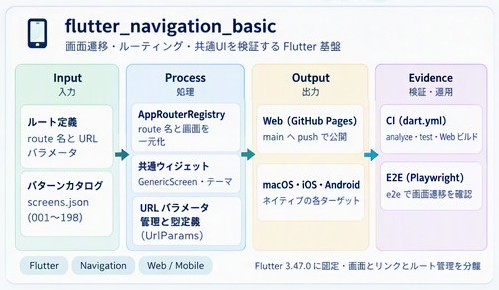
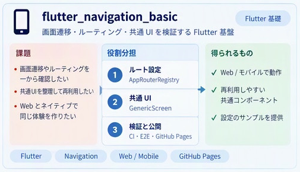

# flutter_navigation_basic


Dart / Flutter で書いた、画面遷移・ルーティング・共通UIの検証用の基盤アプリです。リポジトリには Web・iOS・Android のターゲット構成を含みます。

## 概念図



提供された概念図の該当パネルです。画面・ルートの対応は `AppRouteRegistry`、パラメータ取得は `UrlParams` が担当します。図の各ターゲットは概念上の対象を示しており、全ターゲットの構成や動作検証が揃っているという意味ではありません。現在のリポジトリには `macos/` ターゲットは含まれていません。現在の構成と検証手順は以下を参照してください。

### 課題・役割分担・得られるもの



上の構成図を補足する、提供された「課題 → 役割分担 → 得られるもの」の図です。得られるものは設計上の狙いを示しており、全ターゲットで同等の動作や検証完了を保証するものではありません。

## Live Web Demo

`main` への push に対する Flutter ワークフローの成功後、`.github/workflows/flutter-pages.yml` が同じコミットをビルドして GitHub Pages に公開します。

https://myon-bioinformatics.github.io/flutter_navigation_basic/

## Architecture

非機能要件（テーマ・ルート管理・共通ウィジェット・URLパラメータ標準化）を画面ロジックから分けた構成です。

```
lib/
├── main.dart                      # Web・native 共通エントリポイント
├── config.dart / config/
│   ├── app_config.dart
│   └── routes.dart                # 画面ルートの定義
├── core/
│   ├── config/app_config.dart     # 環境変数読み込み・環境切替
│   ├── data_processing/           # データ処理パターンの例（interactive / validation / conversion など）
│   ├── exceptions/
│   ├── logging/
│   ├── navigation/
│   │   ├── app_navigation.dart    # 画面遷移メソッド
│   │   ├── app_route_registry.dart # route名 → 画面ビルダーの対応（ルートの単一の出所）
│   │   ├── app_tools.dart
│   │   └── route_names.dart       # route名の定数
│   ├── services/
│   └── utils/
│       ├── url_params.dart        # URLパラメータ取得ユーティリティ
│       └── ascii_fullwidth.dart
├── data/                          # ironies.dart・composer.dart・mock_api_client.dart
├── features/                      # 機能ごとのまとまり（presentation / domain など）
│   ├── api_patterns/              # APIパターン（001〜198）
│   ├── data_processing_patterns/  # データ処理パターン（001〜198）
│   ├── navigation_patterns/       # 画面遷移パターン（001〜198）
│   ├── ui_theme_patterns/
│   ├── clipboard_shelf/ coordinate_tool/ counter_playground/ composition_generator/
│   ├── home/ http_request_draft/ irony_generator/ now_timeline/ photo_studio/ screen5/
├── screens/                       # 画面本体（hub_screen・generic_screen・pattern_template_screen など）
├── shared/                        # bootstrap・catalog・clipboard・diagnostics など共通部品
└── widgets/
```

## 主な画面・ルート

共通ルートは `lib/core/navigation/route_names.dart` と `app_route_registry.dart`、公開エントリポイントの追加ルートや番号付きルートは `lib/config/routes.dart` を参照してください。主なルートは次のとおりです。

| 種別 | ルート | 内容 |
|------|--------|------|
| 入口 | `/` | Home。現在日付と主要デモへのナビゲーション |
| 入口 | `/hub` | Hub。画面を検索・一覧表示 |
| ツール | `/tools/location/coordinates` | 緯度経度の検証・十進度／DMS・地図リンク、Maps URL からの座標抽出 |
| ツール | `/tools/media/photo-studio` | 写真の上に枠や印を載せるコーナー（旧 `/tools/location/bounding-box` は互換のため残置） |
| ツール | `/tools/time/now-timeline` | 複数の IANA タイムゾーンを1本のタイムラインにまとめる |
| ツール | `/tools/http/request-draft` | HTTP リクエストの下書き |
| 例 | `/examples/counter-playground` | カウンター（ダメージ／回復の表示、押し続けで連打できる +/-） |
| 例 | `/examples/irony-generator` | `Ironies` からランダムなフレーズを表示 |
| 例 | `/examples/composition-generator` | キー／BPM 生成などの軽量な作曲補助 |
| 例 | `/examples/ui-showcase` | UI の見本 |
| 例 | `/examples/external-integration/mcp` | MCP 連携の例 |
| 互換 | `/examples/mock-api` | HTTP リクエスト下書き画面への別名 |
| 例 | `/core/clipboard-shelf` | クリップボード棚 |
| パターン | `/screen1`〜`/screen198` | パターンカタログ。基本は `GenericScreen` が `assets/screens.json` を読み込み、一部の番号は専用画面に割り当てる |

### パターンカタログ

`api_patterns`・`navigation_patterns`・`data_processing_patterns`・`ui_theme_patterns` の4系統があり、それぞれ `pattern_001_to_099` と `pattern_100_to_198` に分かれています。ID は 001〜198 です。パターンの定義データは `assets/` 配下に置き、`assets/screens.json` を画面カタログとして読み込みます。

## URLパラメータ標準化（非機能）

`lib/core/utils/url_params.dart` に GetX のパスパラメータ・クエリパラメータを型安全に取得するユーティリティを集約しています。

| Case | メソッド | 説明 | 例 |
|------|---------|------|----|
| 1 | `UrlParams.pathString('key')` | パスパラメータ → String | `/user/:id` → `'42'` |
| 2 | `UrlParams.pathInt('key')` | パスパラメータ → int | `/item/:id` → `10` |
| 3 | `UrlParams.pathDouble('key')` | パスパラメータ → double | `/price/:amount` → `3.14` |
| 4 | `UrlParams.pathBool('key')` | パスパラメータ → bool | `/feature/:enabled` → `true` |
| 5 | `UrlParams.hasPath('key')` | パスパラメータの存在確認 | `/resource/:key` |
| 6 | `UrlParams.queryString('key')` | クエリパラメータ → String | `?q=flutter` |
| 7 | `UrlParams.queryInt('key')` | クエリパラメータ → int | `?page=2` |
| 8 | `UrlParams.queryDouble('key')` | クエリパラメータ → double | `?zoom=1.5` |
| 9 | `UrlParams.queryBool('key')` | クエリパラメータ → bool | `?darkMode=true` |
| 10 | `UrlParams.hasQuery('key')` | クエリパラメータの存在確認 | `?debug=1` |
| 11 | `UrlParams.queryList('key')` | カンマ区切りクエリ → List\<String\> | `?tags=flutter,dart` |
| 12 | `UrlParams.queryIntList('key')` | カンマ区切りクエリ → List\<int\> | `?ids=1,2,3` |
| 13 | `UrlParams.allPathParams()` | 全パスパラメータ → Map | `/user/:userId/post/:postId` |
| 14 | `UrlParams.allQueryParams()` | 全クエリパラメータ → Map | `?q=hello&lang=ja` |
| 15 | `UrlParams.pathDate('key')` | パスパラメータ → DateTime? | `/schedule/2024-01-15` |
| 16 | `UrlParams.queryDate('key')` | クエリパラメータ → DateTime? | `?from=2024-01-01` |
| 17 | `UrlParams.pathEnum('key', values, fallback: ...)` | パスパラメータ → Enum | `/mode/dark` |
| 18 | `UrlParams.queryEnum('key', values, fallback: ...)` | クエリパラメータ → Enum | `?order=asc` |

> 新しい取得パターンは `UrlParams` クラスにメソッドを追加し、`UrlParamsCases.cases` にエントリを追記します。

### 設計方針

- **ルート管理**: 共通ルートを `AppRouteRegistry` に集約し、公開エントリポイントの追加ルートは `AppRoutes` で組み立てる。
- **データ分離**: パターン定義は `assets/` の JSON から読み込み、画面コードと分ける。
- **共通ウィジェット**: 共通UIを再利用し、パターンごとの違いだけを画面側に持つ。
- **Web対応**: Flutter Web / Chrome で同じルートと画面を確認できる。

## How to Run

```bash
flutter pub get
flutter run
```

Chrome でデバッグする場合:

```bash
flutter run -d chrome
```

Web release build をローカルで確認する場合:

```bash
flutter build web --release --base-href "/flutter_navigation_basic/"
```

Playwright の E2E は `e2e/` にあります。Flutter Web を `http://localhost:8080` で配信した状態で:

```bash
cd e2e
npm install
npx playwright install chromium
npx playwright test --project=chromium
```

## CI

- Pull Request では `.github/workflows/dart.yml` が analyze・test・Flutter Web build を検証します。パス判定（path filter）で、変更された領域に応じて実行するジョブを選びます。固定版のジョブは Flutter `3.47.0` を使い、latest-stable の検証ジョブもあります。
- Python / Playwright 系の検証は `.github/workflows/non-dart.yml` が担当します。
- `.github/workflows/flutter-pages.yml` は `main` の Flutter ワークフロー成功を受けて、そのコミットをチェックアウトします。Pages 側で analyze と Web build を実行し、テストは先行する Flutter ワークフローの結果をゲートとして GitHub Pages へデプロイします。

エージェント間の PR コメントは `AGENTS.md` の `from:` / `to:` ヘッダで宛先を明示します。

### Repository timestamps in Home diagnostics

Home の日付は端末の現在日付です。Home と Build diagnostics に表示するコミット時刻は、正規化された `head.timestamp` から取ります。メタデータの生成時刻は正規化された `generated_at` から取ります。Dart 側のアダプタは両方の文字列をタイムゾーンのオフセットごと保持し、Git を読むことも端末の時計で代用することもしません。古い診断アセットでは、時刻を推測せず「不明」と表示します。Pages では、ソースのスナップショットを `web` / `release` として示します。リリース成果物のサイズは、実際の成果物が渡されるまで計測しません。

Now Timeline のタイムゾーン生成アセット・対応期間・再生成手順は [Generated zone table](docs/GENERATED_ZONE_TABLE.md) を参照してください。

